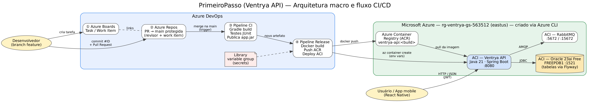

# PrimeiroPasso — Ventrya API · DevOps Tools & Cloud Computing (Global Solution 2026/2)

## Solução proposta

O **PrimeiroPasso** é uma plataforma mobile de inclusão profissional para quem busca o primeiro emprego e ainda não tem experiência. Ela junta **desafios práticos supervisionados**, publicados por ONGs e organizações parceiras, que viram projetos no **portfólio** do participante, com um **simulador de entrevistas com IA (EntrevistaLab)**.

Este repositório tem a **API Java (Ventrya API)** da solução e toda a esteira DevOps que a coloca em nuvem com **Azure DevOps** (Boards, Repos e Pipelines) e **Azure** (ACR + ACI).

## Arquitetura macro



| Camada | Recurso | Detalhe |
|---|---|---|
| Código e versionamento | Azure Repos | `main` protegida: PR obrigatório, revisor, work item vinculado |
| Gestão | Azure Boards | Task vinculada a branch, commits (`#ID`) e PR |
| CI | Azure Pipelines (YAML) | Gradle → testes JUnit 5 → publica `app.jar` + Dockerfile |
| Release | Azure Pipelines (YAML) | Docker build → push no ACR → deploy no ACI |
| Registro de imagens | Azure Container Registry | `acrventrya563512` |
| Aplicação | Azure Container Instance | Java 21 + Spring Boot 4, porta 8080 |
| Banco de dados | Azure Container Instance | Oracle 23ai Free (`FREEPDB1`), schema via Flyway |
| Mensageria | Azure Container Instance | RabbitMQ (eventos de submissões e entrevistas) |

## Estrutura do repositório

```
azure-pipeline.yml        # Pipeline CI + Release (raiz)
dockerfiles/Dockerfile    # Imagem da API
scripts/infra-azure.sh    # Azure CLI: RG, ACR, ACI Oracle, ACI RabbitMQ
scripts/script-bd.sql     # DDL de todas as tabelas (Oracle)
scripts/destroy-azure.sh  # Remove os recursos
scripts/sync-source.sh    # Sincroniza o código com o repo de Java Advanced
docs/arquitetura.png      # Desenho da arquitetura
ventrya-api/              # Código-fonte da API (Gradle, Java 21)
```

## Provisionamento (Azure CLI)

No **Azure Cloud Shell (Bash)**:

```bash
bash scripts/infra-azure.sh
```

O script cria os recursos, gera as senhas na hora (nenhuma senha fica no código) e salva as variáveis em `~/ventrya-secrets.txt`. Essas variáveis vão para o variable group **`ventrya-vars`** do Azure DevOps.

## Pipelines

**CI** (stage `CI`): roda a cada merge na `main`, que só recebe código via Pull Request.
1. Configura o Java 21.
2. `./gradlew test`: testes unitários JUnit 5 + Mockito (`AuthService`, `OrganizationService`, `ChallengeService`).
3. Publica o resultado dos testes (aba *Tests*).
4. `./gradlew bootJar`: gera o pacote.
5. Publica o artefato `ventrya-api` (`app.jar` + `Dockerfile`).

**Release** (stage `Release`): roda automaticamente quando a CI gera um artefato novo.
1. Baixa o artefato.
2. Faz o `docker build` e o push para o ACR (tag = número do build).
3. Recria o ACI da API com as **variáveis de ambiente** (`DB_URL`, `DB_USERNAME`, `DB_PASSWORD`, `JWT_SECRET`, `RABBITMQ_*`). As senhas vêm de variáveis secretas.
4. Smoke test: confere se a API responde na nuvem.

### Variáveis (Library → `ventrya-vars`)

`RG`, `LOCATION`, `ACR_NAME`, `ACR_USERNAME`, `ACR_PASSWORD`🔒, `ACI_APP_NAME`, `DNS_APP`, `DB_URL`, `DB_USERNAME`, `DB_PASSWORD`🔒, `JWT_SECRET`🔒, `RABBITMQ_HOST`, `RABBITMQ_USER`, `RABBITMQ_PASSWORD`🔒

## Banco de dados

O schema é versionado com **Flyway** (`ventrya-api/src/main/resources/db/migration`) e é aplicado automaticamente quando a API sobe. O DDL consolidado está em [`scripts/script-bd.sql`](scripts/script-bd.sql).

Tabelas: `ventrya_user`, `ventrya_organization`, `ventrya_organization_user`, `ventrya_challenge`, `ventrya_application`, `ventrya_submission`, `ventrya_feedback`, `ventrya_portfolio`, `ventrya_interview`, `ventrya_interview_question`.

## Testes da API (JSON)

Base URL: `http://ventrya-api-563512.eastus.azurecontainer.io:8080`
Rotas protegidas usam o header `Authorization: Bearer <token>`.

### Usuários — `ventrya_user`

**Create** — `POST /api/auth/register`
```json
{
  "name": "Maria Silva",
  "email": "maria.silva@teste.com",
  "password": "senha12345",
  "professionalArea": "TECHNOLOGY"
}
```
`professionalArea`: `TECHNOLOGY` | `ADMINISTRATION` | `MARKETING` | `DESIGN` | `FINANCE` | `OTHER`

**Login** — `POST /api/auth/login`
```json
{
  "email": "maria.silva@teste.com",
  "password": "senha12345"
}
```

**Read** — `GET /api/users/me` (com token)

### Organizações — `ventrya_organization`

**Read** — `GET /api/organizations?page=0&size=10` · `GET /api/organizations/{id}`

Corpo para Create/Update (`OrganizationRequestDTO`):
```json
{
  "name": "ONG Futuro Jovem",
  "email": "contato@futurojovem.org",
  "description": "ONG que apoia jovens em busca do primeiro emprego.",
  "webSite": "https://futurojovem.org"
}
```

### Desafios — `ventrya_challenge`

**Read** — `GET /api/challenges` · `GET /api/challenges/{id}` · `GET /api/challenges/area/{area}` · `GET /api/challenges/organization/{organizationId}`

Corpo para Create/Update (`ChallengeRequestDTO`):
```json
{
  "title": "Planilha de inscrições do evento",
  "description": "Criar uma planilha para organizar as inscrições de um evento comunitário.",
  "professionalArea": "ADMINISTRATION",
  "difficulty": "BEGINNER",
  "requirements": "Excel ou Google Sheets",
  "deadline": "2026-12-15"
}
```

> Os endpoints `POST`, `PUT` e `DELETE` de organizações e desafios ainda estão sendo implementados na disciplina de Java Advanced. Esta seção vai ser atualizada com as rotas finais.

### Conferência no banco (SQL Developer)

Host: `ventrya-db-563512.eastus.azurecontainer.io` · Porta `1521` · Service name `FREEPDB1` · Usuário `ventrya`

```sql
SELECT id, name, email, role, created_at FROM ventrya_user ORDER BY id;
SELECT * FROM ventrya_organization ORDER BY id;
SELECT * FROM ventrya_challenge ORDER BY id;
```

## Integrantes

| RM | Nome completo | Turma |
|---|---|---|
| RM563512 | Felipe Maglio Filho | 2TDSPF |
| RM563509 | Vitória Valentina Maglio | 2TDSPX |
| RM564930 | Mateus Granja dos Santos | 2TDSPF |
| RM564339 | João Pedro Bitencourt Goldoni | 2TDSPX |
| RM561786 | Marina Tamagnini Magalhães | 2TDSPX |
